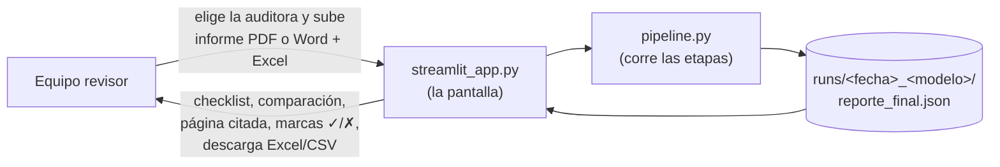
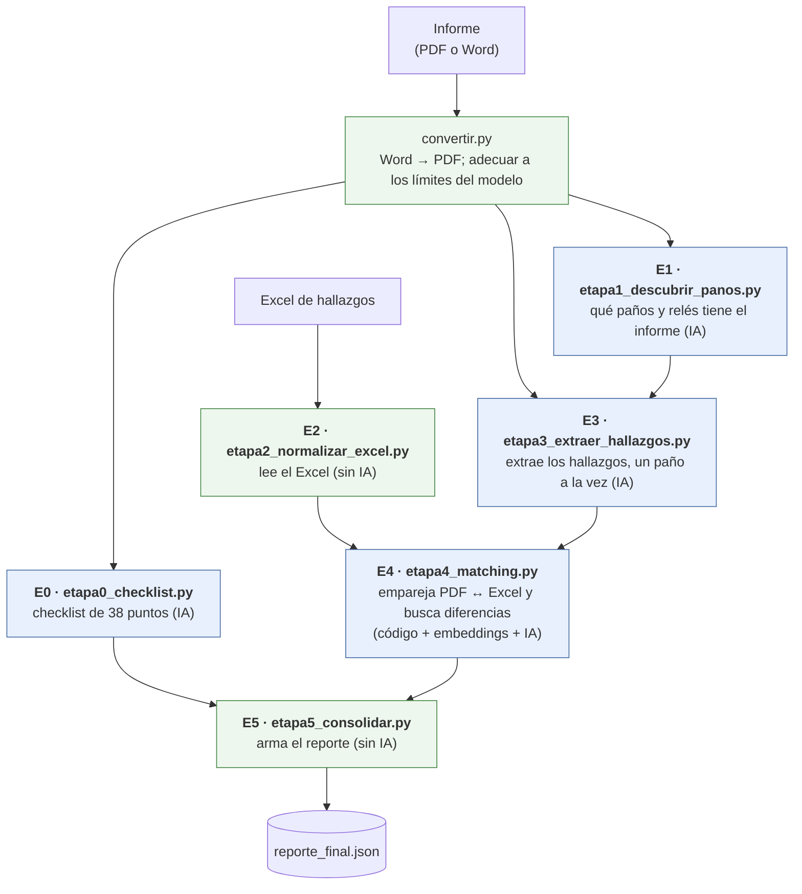
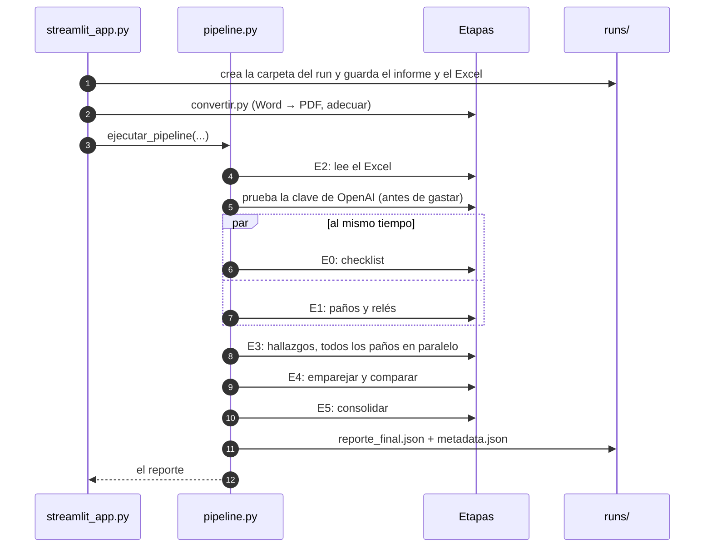
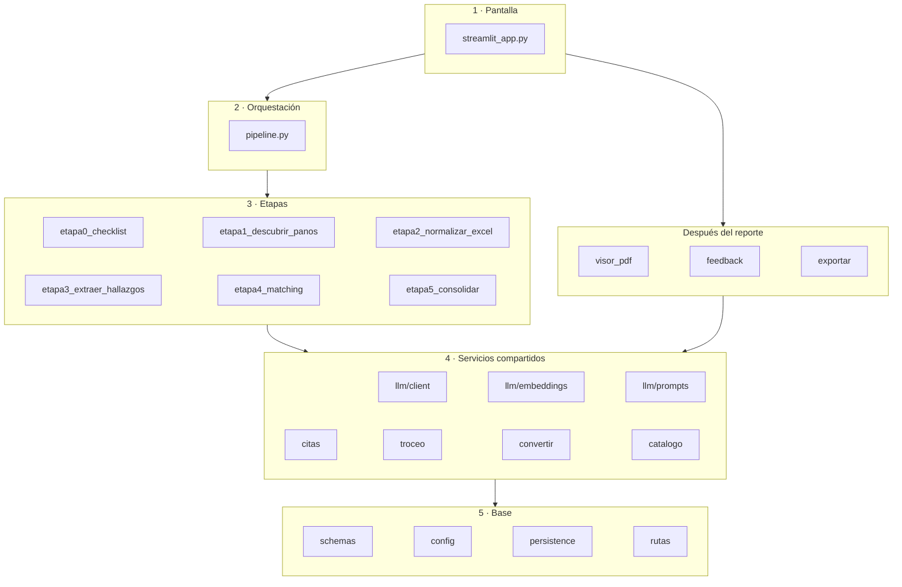
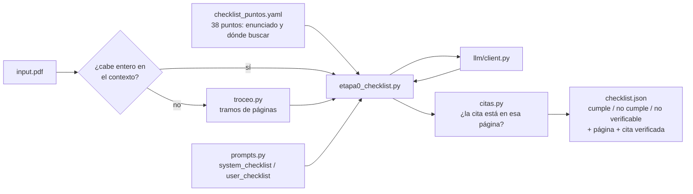
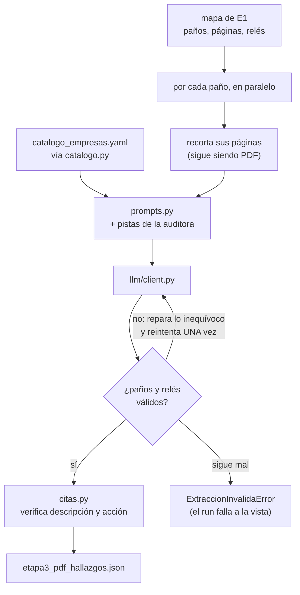
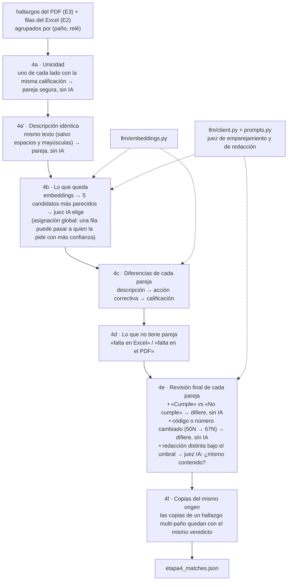
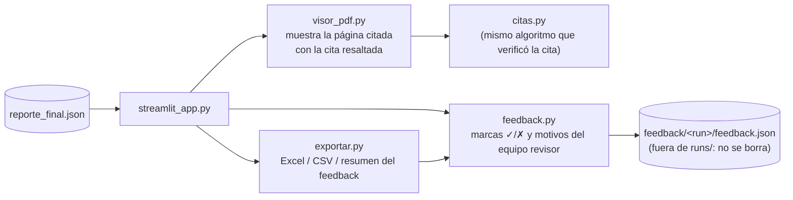
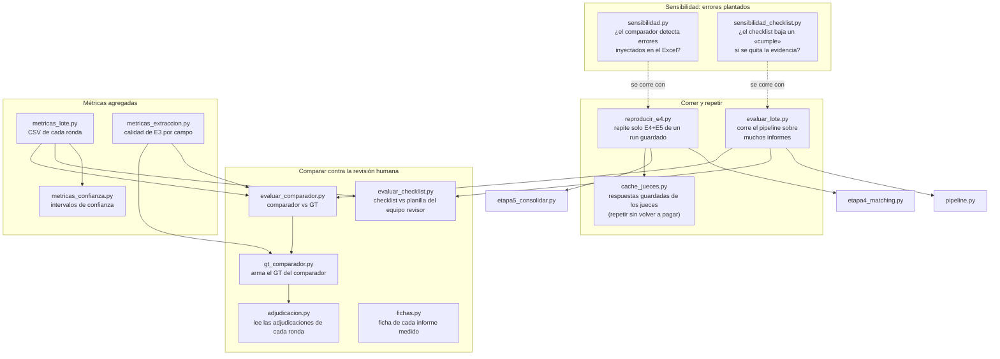

# Cómo está ordenado el código

Este documento explica para qué sirve cada archivo Python y cómo se conectan entre sí. Va de lo
general a lo particular:

1. [El recorrido de un informe](#1-el-recorrido-de-un-informe): qué entra, qué sale.
2. [Las etapas](#2-las-etapas): el corazón de la herramienta.
3. [El mapa de archivos por capas](#3-el-mapa-de-archivos-por-capas): todos los `.py` de la
   herramienta.
4. [Cada etapa por dentro](#4-cada-etapa-por-dentro): qué archivos usa cada una.
5. [Lo que queda en `runs/`](#5-lo-que-queda-en-runs): qué archivo escribe cada etapa.
6. [Después del reporte](#6-después-del-reporte): visor, marcas del equipo revisor, exportación.
7. [Las herramientas de medición](#7-las-herramientas-de-medición): los `.py` que no son de la
   herramienta, sino para medirla.
8. [Ficha de cada archivo](#8-ficha-de-cada-archivo): una tabla con todos.
9. [Configuración y tests](#9-configuración-y-tests).
10. [Por dónde empezar a leer](#10-por-dónde-empezar-a-leer).

El diseño con sus decisiones y su porqué está en [`DISENO.md`](DISENO.md); las reglas que no se
pueden romper («invariantes»), en [`CLAUDE.md`](CLAUDE.md), parte 5.

---

## 1. El recorrido de un informe

Hay dos partes que se corren juntas sobre el mismo informe:

- **Checklist** (Etapa 0): los 38 puntos de la planilla de revisión, cada uno «cumple», «no
  cumple» o «no verificable», con la página y una cita que el código comprueba.
- **Comparador** (Etapas 1 a 5): cada hallazgo de las tablas del informe frente a cada fila del
  Excel, paño por paño y relé por relé.

Todo termina en **un solo archivo**, `reporte_final.json`. La pantalla solo lee ese archivo: no
calcula nada por su cuenta (invariantes 22 a 24).

---

## 2. Las etapas

| Etapa | Archivo | Qué hace | ¿Usa IA? |
|---|---|---|---|
| E0 | `etapa0_checklist.py` | Revisa los 38 puntos del checklist con el PDF completo | Sí (una llamada, o una por tramo si el informe es muy largo) |
| E1 | `etapa1_descubrir_panos.py` | Lista los paños que el informe audita, sus páginas y sus relés | Sí (una llamada) |
| E2 | `etapa2_normalizar_excel.py` | Lee el Excel y lo deja en el formato común (el «schema canónico») | No |
| E3 | `etapa3_extraer_hallazgos.py` | Por cada paño, recorta sus páginas y extrae sus hallazgos al mismo formato | Sí (una llamada por paño, en paralelo) |
| E4 | `etapa4_matching.py` | Empareja cada hallazgo del PDF con su fila del Excel y marca qué difiere | Embeddings + juez IA solo donde el código no alcanza |
| E5 | `etapa5_consolidar.py` | Cuenta, ordena y arma el `reporte_final.json` | No |

**El orden real** (lo decide `pipeline.py`):

E2 va primero porque no cuesta nada: si el Excel viene mal, el run falla antes de pagar una sola
llamada. E0 y E1 leen el mismo PDF y no dependen una de la otra, así que corren a la vez.

---

## 3. El mapa de archivos por capas

Todos los archivos están en `src/comparador/`, salvo `streamlit_app.py` (raíz) y los generadores
de `samples/`. Una flecha `A → B` significa «A usa a B».

Cada capa usa solo a las de abajo, nunca a las de arriba: una etapa no sabe nada de la pantalla, y
`schemas.py` no sabe nada de nadie. Hay atajos hacia abajo (la pantalla usa `convertir.py` y
`persistence.py` directamente, el pipeline usa `persistence.py`) y entre etapas vecinas (E1 y E3
reusan funciones de lectura de E2 y E1), pero ninguna flecha sube.

**Quién usa a quién**, con detalle (el `.py` se omite):

| Archivo | Usa a |
|---|---|
| `streamlit_app` | `pipeline`, `convertir`, `visor_pdf`, `feedback`, `exportar`, `citas`, `catalogo`, `persistence` |
| `pipeline` | las seis etapas, `catalogo`, `llm/embeddings` (prueba la clave), `persistence` |
| `etapa0_checklist` | `llm/client`, `llm/prompts`, `citas`, `troceo` |
| `etapa1_descubrir_panos` | `llm/client`, `llm/prompts`, `troceo`, y de `etapa2` la lectura de códigos de paño |
| `etapa2_normalizar_excel` | solo `schemas` |
| `etapa3_extraer_hallazgos` | `llm/client`, `llm/prompts`, `citas`, `catalogo`, y normalizaciones de `etapa1` y `etapa2` |
| `etapa4_matching` | `llm/client`, `llm/embeddings`, `llm/prompts` |
| `etapa5_consolidar` | solo `schemas` y `config` |
| `visor_pdf` | `citas` |
| `exportar` | `feedback`, `citas`, y de `evaluar_checklist` la función que clasifica cada punto |
| `feedback` | `persistence`, `rutas` |
| `llm/client` | `convertir` (los límites de cada modelo) |
| `llm/embeddings` | `llm/client` |
| `llm/prompts` | `catalogo` |
| `troceo` | `llm/client` (cuenta tokens) |
| `config` | `rutas` |

Casi todos usan además `schemas` (los tipos) y `config` (la configuración).

**Cómo leer las capas:**

- **Pantalla.** `streamlit_app.py` recibe los archivos, llama al pipeline y muestra el reporte.
  No toma decisiones sobre los datos.
- **Orquestación.** `pipeline.py` corre las etapas en orden, mide los tiempos, guarda cada
  resultado intermedio en `runs/` y, si algo falla, deja el error a la vista.
- **Etapas.** Una por archivo. Cada una recibe datos con los tipos de `schemas.py` y devuelve
  datos con esos mismos tipos.
- **Servicios compartidos.** Lo que usan varias etapas: hablar con el modelo, verificar citas,
  partir PDFs largos, cargar las pistas de cada auditora.
- **Base.** No depende de nada del proyecto (salvo `config.py`, que usa `rutas.py`): los tipos,
  la configuración y la persistencia.
- **Después del reporte.** Lo que la pantalla usa una vez que el reporte existe: el visor de
  páginas, las marcas del equipo revisor y las descargas (sección 6).

---

## 4. Cada etapa por dentro

### E0 · Checklist (`etapa0_checklist.py`)

El modelo copia una cita **antes** de decidir. `citas.py` busca esa cita en la capa de texto del
PDF; un «cumple» sin cita verificada baja a «no verificable» y queda con su motivo a la vista
(invariante 21b).

### E1 · Paños y relés (`etapa1_descubrir_panos.py`)

Una llamada con el PDF entero (o con su primer tramo, si no cabe) devuelve la lista de paños, sus
páginas y los relés de cada paño, incluidos los sub-paños de transformador (CT1A, CT1B…). El
código valida y normaliza solo lo inequívoco; lo que no calza se descarta a la vista (invariante
8b). Es el «mapa» que usa E3.

### E2 · Excel (`etapa2_normalizar_excel.py`)

Sin IA. Lee la Tabla de Hallazgos (formato fijo), separa las filas que aplican a varios paños
(una copia por paño), normaliza la calificación (`Menor`, `Relevante`, `Crítico`; cualquier otro
valor hace fallar el run) y marca como «transversales» las filas que no son de un relé (por
ejemplo «Análisis de coordinación»), que no entran a la comparación (invariante 19b).

### E3 · Hallazgos del PDF (`etapa3_extraer_hallazgos.py`)

Aquí se resuelve que cada auditora nombra distinto las columnas («Conclusión», «Recomendación»…):
el modelo las lleva a los nombres del Excel (`descripcion`, `accion_correctiva`, `calificacion`).
También se separan los hallazgos agrupados: una celda con varios puntos pasa a ser varios
hallazgos, y uno que aplica a varios paños, una copia por paño (invariante 8).

### E4 · Emparejar y comparar (`etapa4_matching.py`)

Es el archivo más grande, porque concentra las reglas de la comparación. Siempre trabaja dentro
de un mismo par (paño, relé): nunca empareja entre paños ni entre relés (invariante 14).

La idea general: **primero el código, la IA solo donde el código no alcanza**, y siempre del lado
seguro: ante la duda nunca se dice «coincide».

### E5 · Reporte (`etapa5_consolidar.py`)

Sin IA. Junta el checklist y los resultados de E4, cuenta los totales del informe (los recuadros
de arriba de la pantalla) y ordena los resultados por paño, relé y estado.

---

## 5. Lo que queda en `runs/`

Cada procesamiento crea `runs/<fecha>_<modelo>/` con todo lo intermedio, para poder auditar
cualquier resultado (invariante 20). Lo escribe `persistence.py`, por encargo de `pipeline.py` y
`streamlit_app.py`. La carpeta queda fuera de git.

| Archivo | Lo escribe | Contiene |
|---|---|---|
| `input.pdf` (o `input.docx` + `input.pdf`) | pantalla | El informe subido (y su conversión) |
| `input_*.hash` | pantalla, pipeline | La huella SHA-256 de cada insumo |
| `version.json` | pipeline | Versión del código, prompts y configuración |
| `etapa2_excel_normalizado.json` | E2 | Las filas del Excel en formato común |
| `checklist.json`, `checklist_raw/` | E0 | El checklist y la respuesta cruda del modelo |
| `etapa1_panos.json`, `etapa1_raw/` | E1 | El mapa de paños y relés |
| `troceo.json` | E0/E1 | Solo si el informe se partió en tramos |
| `etapa3_pdf_hallazgos.json`, `etapa3_raw/` | E3 | Los hallazgos del PDF, con el raw de cada paño (y de su reintento) |
| `config_e4.json` | pipeline | Umbrales e interruptores con que corrió E4 |
| `etapa4_matches.json`, `etapa4_llm_judge_raw/`, `etapa4_redaccion_raw/` | E4 | Las parejas y lo que respondió cada juez |
| `etapa4_embeddings.npz` | E4 | Los vectores calculados (sirven para repetir E4 sin pagarlos) |
| `reporte_final.json` | E5 | **El reporte**: lo único que lee la pantalla |
| `metadata.json` | pipeline | Tiempos por etapa, tokens, totales y la configuración con que corrió |
| `error.json` | pantalla | Solo si el run falló: el error completo |

`persistence.py` además aplica la retención: guarda los 3 últimos runs completos y el último
incompleto, y borra el resto (invariante 21).

---

## 6. Después del reporte

- `visor_pdf.py` usa el mismo algoritmo que verificó la cita, así que el resaltado nunca
  contradice lo que dice el reporte.
- `feedback.py` guarda solo lo que cambió cada sesión, con un candado entre procesos: dos personas
  marcando el mismo run no se pisan.
- `exportar.py` arma las descargas desde el reporte, sin recalcular nada.

---

## 7. Las herramientas de medición

Además de la herramienta, `src/comparador/` trae los programas con que se midió su calidad. **La
pantalla no los usa** (la única excepción: `exportar.py` toma de `evaluar_checklist.py` la
función que clasifica cada punto). Se corren desde la terminal (`uv run python -m comparador.<nombre>`) y la
mayoría necesita datos privados que no vienen en este repositorio: los informes reales y la
revisión humana de cada uno (el «ground truth» o GT).

`reproducir_e4.py` es la excepción útil: funciona con cualquier run tuyo. Sirve para probar un
cambio en la comparación (un umbral, un interruptor de `.env`) sobre hallazgos ya extraídos, sin
volver a pagar el checklist, E1 ni E3.

---

## 8. Ficha de cada archivo

### La herramienta

| Archivo | Capa | Para qué sirve | Lo usan |
|---|---|---|---|
| `streamlit_app.py` | Pantalla | Subir archivos, elegir auditora, ver el progreso con su tiempo (`mm:ss`), el reporte, la página citada, marcar ✓/✗ y descargar | (el usuario) |
| `pipeline.py` | Orquestación | `ejecutar_pipeline`: corre E2 → E0‖E1 → E3 → E4 → E5 y guarda todo en `runs/`. `ejecutar_solo_checklist`: solo E0 | pantalla, `evaluar_lote` |
| `etapa0_checklist.py` | Etapa | Los 38 puntos del checklist con cita verificada | pipeline |
| `etapa1_descubrir_panos.py` | Etapa | Paños, páginas, relés y sub-paños del informe | pipeline |
| `etapa2_normalizar_excel.py` | Etapa | El Excel al formato común; filas transversales | pipeline |
| `etapa3_extraer_hallazgos.py` | Etapa | Hallazgos del PDF por paño, con reparación y un reintento | pipeline |
| `etapa4_matching.py` | Etapa | Emparejar y comparar (4a a 4f) | pipeline, `reproducir_e4` |
| `etapa5_consolidar.py` | Etapa | Totales, orden y `ReporteInforme` | pipeline, `reproducir_e4` |
| `llm/client.py` | Servicio | Única puerta a los modelos: elige proveedor por el nombre (`claude-*` → Anthropic, resto → OpenAI), manda el PDF (en línea o por Files API), pide salida estructurada, reintenta errores de red, cuenta tokens | E0, E1, E3, E4, troceo, embeddings |
| `llm/embeddings.py` | Servicio | Embeddings de OpenAI, similitud coseno, los 5 más parecidos y la prueba de la clave | E4, pipeline |
| `llm/prompts.py` | Servicio | Todas las instrucciones que recibe el modelo, en un solo lugar | E0, E1, E3, E4 |
| `citas.py` | Servicio | Comprueba que una cita exista en su página del PDF (sin IA) | E0, E3, visor, pantalla |
| `troceo.py` | Servicio | Parte en tramos los informes que no caben en el contexto del modelo | E0, E1 |
| `convertir.py` | Servicio | Word → PDF; con un modelo que no es Claude, rasteriza el PDF que pesa demasiado y rechaza el de más de 100 páginas (nunca lo recorta) | pantalla, `llm/client.py` |
| `catalogo.py` | Servicio | Carga las pistas de la auditora elegida; falla si no existe | E3, prompts, pantalla |
| `schemas.py` | Base | Los tipos de datos (Pydantic): `Hallazgo`, `MatchResult`, `ReporteInforme`, `Calificacion`, `EmpresaAuditora`… | casi todos |
| `config.py` | Base | Lee `.env`: claves, modelo, umbrales e interruptores (`settings`) | casi todos |
| `persistence.py` | Base | Crea la carpeta del run, guarda JSON, raw y vectores, aplica la retención | pipeline, pantalla, medición |
| `rutas.py` | Base | Compara rutas y evita que una salida privada caiga dentro de git | config, feedback, medición |
| `visor_pdf.py` | Después | Renderiza la página citada con la cita resaltada | pantalla |
| `feedback.py` | Después | Lee y guarda las marcas del equipo revisor en `feedback/` | pantalla, exportar |
| `exportar.py` | Después | Reporte a Excel y CSV, y el resumen del feedback | pantalla |

### Medición (no la usa la pantalla)

| Archivo | Para qué sirve |
|---|---|
| `evaluar_lote.py` | Corre el pipeline sobre una carpeta de informes y evalúa cada uno |
| `evaluar_checklist.py` | Compara el checklist con la planilla del equipo revisor (acierto, no verificable, falso cumple, falso no cumple) |
| `evaluar_comparador.py` | Compara cada resultado del comparador con el GT, por claves estables |
| `gt_comparador.py` | Une las adjudicaciones de las rondas en un GT por informe |
| `adjudicacion.py` | Lee las adjudicaciones y arma las claves con que se buscan en otro reporte |
| `fichas.py` | Ficha de cada informe medido (fechas, huellas, revisor anónimo) |
| `metricas_lote.py` | CSV agregados de cada ronda de medición |
| `metricas_confianza.py` | Intervalos de confianza y estabilidad de las cifras del checklist |
| `metricas_extraccion.py` | Calidad de E3, campo por campo |
| `reproducir_e4.py` | Repite E4 y E5 de un run guardado |
| `cache_jueces.py` | Reutiliza las respuestas de los jueces de un run para no volver a pagarlas |
| `sensibilidad.py` | Planta errores en el Excel y mide cuántos detecta el comparador |
| `sensibilidad_checklist.py` | Quita del PDF la evidencia de un «cumple» y mide si el checklist lo nota |

### Fuera de `src/`

| Archivo | Para qué sirve |
|---|---|
| `samples/generar_sinteticos.py` | Crea un informe PDF y un Excel inventados para probar la herramienta |
| `samples/generar_sinteticos_v2.py` | Un segundo par, con casos más difíciles (sin columna de relé, calificación implícita, hallazgos multi-paño) |
| `run_streamlit.cmd` | En Windows, abre la herramienta con doble clic |

---

## 9. Configuración y tests

**Archivos de configuración** (en `src/comparador/`; cambiarlos no es un cambio de schema):

| Archivo | Lo lee | Contiene |
|---|---|---|
| `checklist_puntos.yaml` | E0 | Los 38 puntos: enunciado, dónde buscar y el origen de cada criterio |
| `catalogo_empresas.yaml` | `catalogo.py` → E3 | Las pistas de cada auditora (cómo arma sus tablas, qué filas son transversales) |
| `mapeo_checklist_gt.yaml` | `evaluar_checklist.py` | Cómo se cruzan los puntos con la planilla de revisión |
| `.env` (desde `.env.example`) | `config.py` | Claves de API, modelo e interruptores (`ASIGNACION_GLOBAL`, `JUEZ_REDACCION`, …) |

**Tests** (`tests/`, se corren sin llamar a ninguna API):

- `test_<módulo>.py`: uno o varios por archivo, por ejemplo `test_etapa4_asignacion_global.py`
  prueba solo la parte 4b de la asignación global.
- `test_integracion_pipeline.py`: el pipeline completo con un modelo falso.
- `test_streamlit_app.py`: la pantalla, con el probador de Streamlit.
- `test_privacidad_git.py`: que ningún dato privado pueda entrar a git.
- `tests/golden/`: comparan contra informes reales; sin esos datos no se recolectan.

---

## 10. Por dónde empezar a leer

1. `schemas.py`: los tipos de datos. Todo lo demás los pasa de mano en mano.
2. `pipeline.py`, función `ejecutar_pipeline`: el orden de las etapas en unas 200 líneas.
3. `etapa2_normalizar_excel.py`: la etapa más simple, sin IA.
4. `llm/client.py` y `llm/prompts.py`: cómo se habla con el modelo y qué se le pide.
5. `etapa3_extraer_hallazgos.py` y `etapa4_matching.py`: donde vive la lógica difícil.
6. `streamlit_app.py`: cómo se presenta todo.
